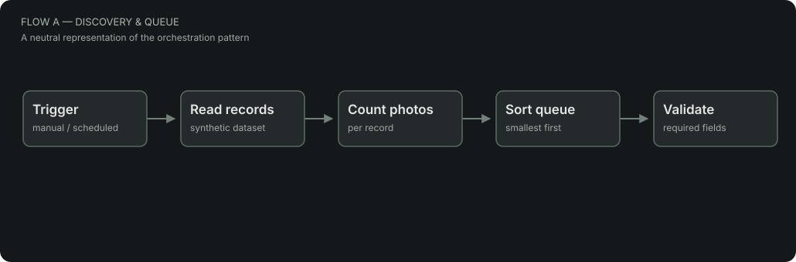
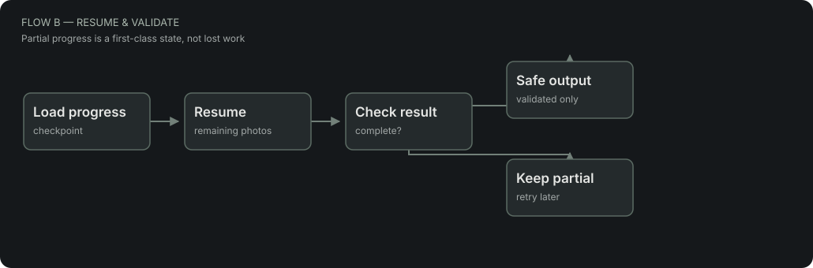

# Automation Workflow Showcase

A small technical case study about connecting systems and making automations recoverable.

This is an **independent, synthetic recreation** inspired by my work with workflow automation, AI-assisted processing and browser tools. It is **not** a client system, a copy of a production workflow or an export of business data. All names, records, outputs and operations are fictional.



## What it demonstrates

- **Orchestration:** read records, validate inputs and prioritize smaller jobs.
- **Resumable processing:** store progress and continue after a simulated rate limit.
- **Fail-closed validation:** incomplete results cannot be exported as publishable output.
- **Browser tooling:** optional local-only userscripts for filling and auditing multilingual fields.
- **Data modeling:** a workspace-database schema with progress, status and error metadata.

No APIs, cloud accounts, credentials or real property websites are used.

## Quick start

Requires Python 3 (for the local static server). Node.js 18+ is optional for tests.

```bash
python -m http.server 4173
```

Open [http://localhost:4173](http://localhost:4173) and try **Simulate rate limit**, then **Process next**. Nothing is sent to a server: the state lives in the page until you reset or refresh it.

```bash
npm test
```

## Project map

| Location | Purpose |
| --- | --- |
| [`index.html`](index.html) | Minimal browser showcase and interactive simulation |
| [`src/engine.js`](src/engine.js) | Pure JavaScript queue, checkpoint, resume and output-validation logic |
| [`workflows/`](workflows) | Two importable, offline n8n **illustrations**, using only manual triggers and local Code nodes |
| [`userscripts/`](userscripts) | Demonstration Tampermonkey scripts, restricted to `localhost:4173/demo/editor.html` |
| [`demo/editor.html`](demo/editor.html) | Fictional multilingual content form for testing userscripts |
| [`data/`](data) | Fictional records; no real property names or addresses |
| [`docs/`](docs) | Architecture, database model and publishing safeguards |

## Architecture



The browser simulation is deliberately simplified: it processes one record at a time, uses deterministic mock captions instead of a model API, and preserves the photo index after an artificial interruption. The n8n examples illustrate the underlying patterns; they do **not** connect to external tools, do not reconstruct the complete production workflow and are not meant to be deployed as-is.

For details: [architecture](docs/architecture.md) · [example database schema](docs/notion-schema.md) · [security notes](docs/security.md).

## Background

My interests sit between **automation engineering and software development**: JavaScript/TypeScript, API integration, workflow reliability, web applications, SQL and business intelligence. This project is a compact way to explain how I think about connecting systems without publishing client work.

— [Laura Kayamori](https://github.com/kayamorilaura)
