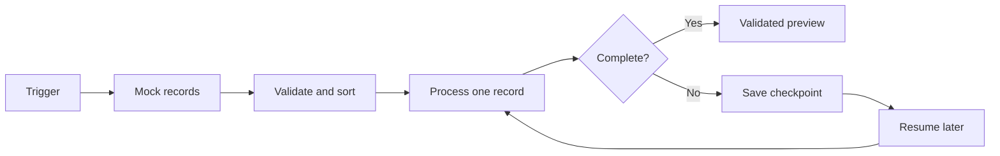

# Architecture notes

The project is an intentionally small, offline illustration of two related workflow responsibilities.

## A. Discover and prioritize

1. Load **fictional** records from a local JSON file.
2. Verify that each record has an ID and a set of photos.
3. Sort records by the number of photos to process shorter jobs first.
4. Select one unfinished record.
5. Start processing in the local simulation.

No scraping, CRM, listing website or workspace API is included.

## B. Process, recover and validate

1. Work through synthetic photo labels in order.
2. Save the index of the next photo in memory along with previous output.
3. If a simulated rate limit occurs, mark the record `PARTIAL`, retain results and display its checkpoint.
4. At the next run, continue from the saved index, without reprocessing earlier items.
5. Mark the record `VALIDATED` only when every expected photo is present and ordered correctly.
6. Permit JSON export **only** for validated records.

Actual provider calls, exponential backoff, durable persistence, observability, authorization and production concurrency controls are intentionally outside this demonstration.

## Diagram

## Why this matters

The software design choices matter more than any specific vendor integration: determinism, idempotent progress, explicit partial states and a gate before output is trusted. All components here are educational and safe to inspect.
